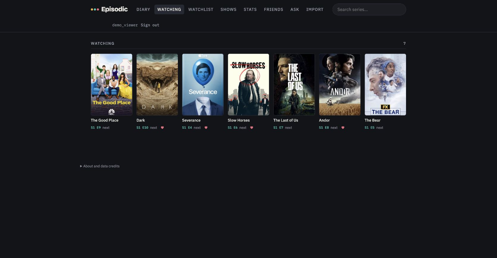
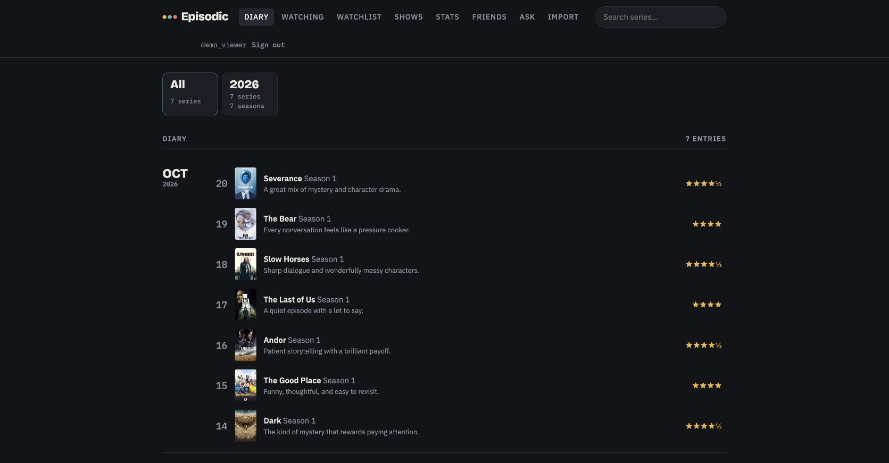

# Episodic

An invite-only TV diary with episode tracking, ratings, Netflix CSV import, watchlists, friend profiles and optional AI recommendations. The interface is a vanilla JavaScript page; the backend runs on Cloudflare Workers with KV storage.

This repository contains a standalone version of the application. It includes no accounts, diaries, passwords, invite codes, API keys, production account identifiers, generated catalogs or private development history. It does not deploy to the author's website.

[Open the hosted app](https://berkkalelioglu.com/episodic/). Signup is invitation-only; the source can also be run locally with your own configuration.





Screenshots use a synthetic account with fictional viewing activity, not a real user's diary. Show metadata and posters are supplied by TVmaze and belong to their respective rightsholders.

A personal hobby project developed with **Claude Code and Codex**, with no expectation of revenue. Episodic is independent and is not affiliated with, endorsed by or sponsored by Letterboxd.

## Local development

Use Node.js 22:

```sh
npm ci
cp .dev.vars.example .dev.vars
npm run dev
```

Fill `EPISODIC_SECRET` and `EPISODIC_INVITE` with different, randomly generated values in the ignored `.dev.vars` file. Use at least 32 random bytes for each production secret. Open the local URL printed by Wrangler, then `/episodic/`. Local KV and quotas are isolated from production. Sign up using your local invite code.

The diary, search and friends features do not need a paid AI key. TVmaze supplies show metadata directly to the browser. To enable Ask, supply your own `OPENROUTER_API_KEY`, or `ANTHROPIC_API_KEY` as a fallback. Never put either in HTML, JavaScript served to the browser, wrangler variables or Git. Review provider data handling before sending viewing history, ratings and comments to a model.

## Catalogs

The repository distributes no TMDB/IMDb catalog exports. Empty catalog placeholders are generated locally so the app can run before collection. To populate platform/popular lists, set your own `TMDB_TOKEN` in `.dev.vars` and run:

```sh
npm run catalog
```

The script accepts a TMDB v3 key or v4 read token, obtains regional catalogs, and obtains show metadata from TMDB. Review each data provider's terms and attribution requirements for your usage. The defaults cover Turkey. Generated files stay under ignored `public/episodic/catalog/`; do not publish them or user exports with code. Show pages link to JustWatch for current availability; they do not call its unofficial GraphQL endpoint. IMDb rating datasets are not collected or republished.

## Deploy your own instance

1. Sign into your own Cloudflare account with `npx wrangler login`.
2. Create a KV namespace with `npx wrangler kv namespace create EPISODIC`. Put its returned ID in your local `wrangler.jsonc` instead of the zero placeholder. Choose your own Worker name.
3. Store `EPISODIC_SECRET` and `EPISODIC_INVITE` using `npx wrangler secret put NAME`. Configure a model-provider key only if using Ask.
4. Run `npm test`, `npm run build`, then `npm run deploy`.

The configuration creates a SQLite-backed Durable Object for atomic AI quotas. Existing diaries remain in KV. The root redirects to `/episodic/`; API routes are under `/api/episodic/`. There is no automatic production deployment workflow in this repository. Keep your account-specific config out of contributions; the publication check requires the placeholder KV ID.

## AI limits and privacy

Ask requires an authenticated session and reserves each provider attempt before making a request. Limits are 100 attempts per user per UTC day, 100 across the deployment per UTC day, 20 per minute globally and at least ten seconds between attempts for the same user. Counter failures stop AI calls. Failed provider calls still consume quota and automatic SDK retries are disabled. Output is capped at 4,000 tokens; reference/profile context, message history and request-body sizes are bounded.

These are request limits, not a dollar-denominated spending cap. Set a provider-side budget on a dedicated key as well. The login throttle still uses eventually consistent KV and is not a strict distributed limiter. See [security notes](SECURITY.md) for the trust boundaries and remaining limitations.

## Checks and contributions

```sh
npm run typecheck
npm test
npm run build
npm run check:public
gitleaks git . --redact --log-opts=--all
```

Tests use synthetic users and local storage, including a concurrent-request check against the actual Workers runtime. No production account or paid provider call is needed. CI runs tests, type checks, build and public-file/secret scans. Never add handoffs, agent instructions, user exports, personal paths, real deployment IDs or secrets. Model and third-party data licenses are separate from the code's MIT license.

## Third-party data and credits

The MIT license applies to application code, not to provider data, posters, logos or trademarks. Noncommercial intent does not replace permission or attribution.

- [TVmaze](https://www.tvmaze.com/api) supplies show and episode metadata under CC BY-SA. Credit TVmaze and comply with ShareAlike when redistributing or adapting its data. The interface selects and reformats this metadata.
- [TMDB](https://developer.themoviedb.org/docs/faq) permits noncommercial API use with attribution and its approved logo. This product uses the TMDB API but is not endorsed or certified by TMDB. The app's credits include that notice and logo.
- Regional platform catalogs use availability supplied by JustWatch through TMDB. [JustWatch](https://www.justwatch.com/) is credited in the app. Direct provider integrations require their own terms and permission.
- IMDb's free dataset terms restrict republishing a movie-information database beyond individual personal use. The collector therefore does not download IMDb ratings. External IMDb identifiers received from other providers are only used to match shows.

These source references describe the implemented boundaries; they are not a legal certification of every possible deployment. Obtain appropriate rights before adding datasets, changing distribution or monetizing the app.
